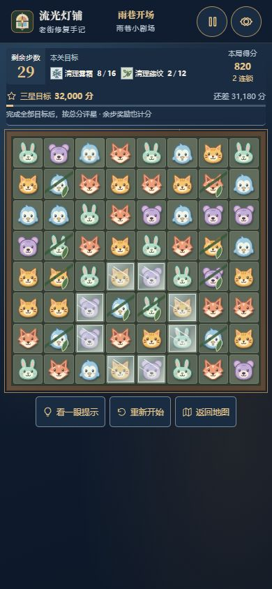
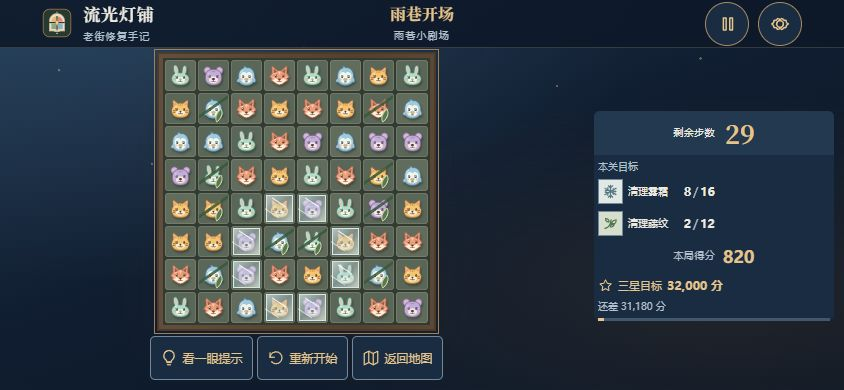

# 流光灯铺 · 三端适配测试报告

检查时间：2026-10-20 至 2026-10-21。测试通过已连接的内置浏览器实际加载本地页面完成，使用浏览器视口覆盖测试尺寸。游戏测试在独立端口 4176 进行，正式端口 4174 的玩家存档未重置。

## 手机方向结论

推荐竖屏，横屏保持可玩，不强制锁定方向。

方形 8×8 棋盘的可用大小由短边和界面高度共同决定。390×844 竖屏中，每格约 42.3px；844×390 横屏中，每格约 31.1px。竖屏更利于识别小动物和选择棋子，目标、得分、三星进度和常用按钮也可完整显示。极小手机横屏 568×320 每格约 22.6px，兼容显示但不建议作为主要游玩方向。

## 已发现并修复

1. 横屏原规则隐藏了当前得分：改为保留右侧紧凑得分行。
2. 手机常用按钮原为 30–32px 高：手机、平板及粗指针环境改为至少 44px 高。
3. 固定减去视口高度不能应对双目标及换行：按实际 HUD、按钮、说明和安全区测量棋盘可用空间。
4. 短划必须跨过格子边界：改为按起点、主方向及距离判断相邻格，支持同格内短划，并处理取消与第二指针。
5. 手机菜单隐藏操作提示入口：加入可见的“操作提示”，不必重新开始主线。
6. 五枚引导棋子在窄屏可能超出说明卡片：缩小该演示的布局间距和尺寸。
7. 横屏地图被压得过矮：保留路线所需高度，允许地图页纵向滚动。
8. 动画中旋转可能使飞行光点沿旧坐标移动：重建当前动画坐标，保留已播放时间及暂停状态，不重算游戏结果。

## 视口检查

下列均为第 36 关真实页面的测量，包含两个障碍目标。十种尺寸下，64 格棋盘、目标、当前得分、三星进度及三枚常用按钮均在可见范围内；游戏页无横向溢出，也不需要纵向滚动才能操作。

| 类别 | 视口 | 棋盘格约宽 | 常用按钮高度 | 结果 |
|---|---:|---:|---:|---|
| 桌面 | 1440×900 | 65.6px | 34px | 通过 |
| 桌面 | 1280×720 | 47.0px | 34px | 通过 |
| 平板竖屏 | 768×1024 | 70.3px | 44px | 通过 |
| 平板横屏 | 1024×768 | 55.4px | 44px | 通过 |
| 手机竖屏 | 390×844 | 42.3px | 44px | 通过 |
| 手机竖屏 | 375×667 | 40.4px | 44px | 通过 |
| 小屏竖屏 | 320×568 | 32.1px | 44px | 通过 |
| 手机横屏 | 844×390 | 31.1px | 44px | 通过 |
| 手机横屏 | 667×375 | 29.5px | 44px | 通过 |
| 小屏横屏 | 568×320 | 22.6px | 44px | 通过，推荐切回竖屏 |

原始测量：[viewport-results.json](testing/viewport-results.json)。

## 逐关与实际操作

- 36 关各在 390×844 手机和 1440×900 桌面打开一次，共 **72 次**真实页面布局检查；全部显示 64 格、1–2 个目标，棋盘与常用按钮完整可见。原始结果：[all-stages.json](testing/all-stages.json)。
- 第 36 关实际鼠标点击、方向键加 Enter、鼠标同格内短拖动，步数依次 **32 → 31 → 30 → 29**，分数依次 **0 → 180 → 360 → 820**。
- 暂停后横竖屏切换，棋子标签、步数、分数完全一致；刷新后继续也一致。
- 浏览器内合成 touch 指针事件经过正式输入处理器：点按、短划各扣一步；取消手势、第二指针、覆盖棋子不扣步。结果：[touch-events.json](testing/touch-events.json)。这属于事件层验证，不是真实触屏硬件验证。
- 320px 窄屏实际走完四页引导，没有横向溢出，继续与跳过均可点击。
- 手机设置弹窗在视口内，可访问原有选项；地图 12 个关卡节点不相互重叠。
- 最后一步失败局面实际进入失败界面，显示未完成目标；点击重试回到 32 步及完整棋盘。
- 第 36 关达标奖励实际执行暂停、旋转、继续、跳过；正常结算为 **8,220 分**，可进入最终结局，再回地图。
- 另一个 4 步奖励局面在暂停、旋转、继续后自动完成，最终 **2,830 分**，奖励 **+2,650 分**。浏览器后续状态确认结算完成。
- 已完成游玩检查时，测试页浏览器错误日志为空。

## 截图

这些是实际浏览器截图，不是设计稿或重新绘制的棋盘。

### 手机竖屏

### 手机横屏

更多：[平板竖屏](testing/tablet-portrait.jpg)、[桌面](testing/desktop.jpg)、[手机失败](testing/failure-mobile.jpg)、[手机结局](testing/ending-mobile.jpg)。

## 自动检查与边界

执行 `npm test` 验证 36 关三星解法、匹配特效、覆盖锁定、奖励、SVG 动物、动画生命周期、响应式尺寸和短划判断；执行 `npm run build` 生成生产目录。构建不包含测试入口和截图。

本次没有真实 iPhone、Android 手机或平板硬件，不声明 Safari、各厂商浏览器及实际刘海／系统手势条均已实机通过。安全区样式已经实现，但真实安全区仍需相应硬件确认。

最后追加的设置刷新检查遇到本地连接中断，错误页地址被自动化浏览器策略拦截，未计为通过项；此前完成的布局、游玩、进度刷新和奖励验证结果不受此项影响。浏览器临时视口覆盖已重置。
